<div align="center">




**Give it a reader's shelf. Get ranked books back, with a reason for each.**
Then find out, with real numbers, whether the book's *text* actually helped.

</div>


## Prologue

I read a lot, and my favourites are character-driven: *Sword of Kaigen*, *The Goldfinch*, *Norwegian Wood*. Recommenders keep pushing me bestsellers. They learn from what readers *do*, so they lean on popular books and have nothing to say about a new book that nobody has read yet. That gap is called the **cold-start problem**.

Bifrost is my attempt to measure it properly, not just demo it. In Norse myth, Bifrost is the bridge between worlds. Here it joins two ways of knowing a book: what readers *did* with it, and what the book *says*.

## The question

> **When does book text (descriptions and reviews) help a recommender more than reader behaviour alone?**

My hypothesis is that text helps most for books with very few readers. It may be wrong, and I'll report whichever result the data gives. A negative result counts.


## Chapters

| | Chapter | Status |
|---|---|---|
| ● | **Setup and decisions:** spec, rules, genre, split design | Done |
| ● | **Ingest:** raw Goodreads files into typed Parquet with DuckDB | Done |
| ◐ | **Data pipeline:** positives, merging editions, k-core filter, stats report | In progress |
| ○ | **Split:** per-user temporal split with leakage tests | Next |
| ○ | **Five models:** popularity, item-kNN, matrix factorization, text, hybrid | Planned |
| ○ | **Evaluation:** NDCG@20 and Recall@20 with bootstrap confidence intervals | Planned |
| ○ | **Serving and demo:** FastAPI, HNSW index, Gradio page | Planned |

*● done, ◐ in progress, ○ not started.*

**What exists today** (real numbers, from the Goodreads Young Adult subset):

- **34,919,254** interactions from **644,686** readers across **93,398** books, loaded into Parquet in about 16 seconds on a laptop.
- 0 rows lost in ingest. Rows without a usable date would be dropped and counted, and none were.
- Tests run on small made-up files, so they need no real data.

There are **no model results yet**, so there's no results table here. It will go in when the numbers exist and can be reproduced with one command.


## Marginalia

Every significant choice is logged in [`DECISIONS.md`](DECISIONS.md) with the alternatives I rejected and what would change my mind. Three that shape the project:

1. **Split by time, per reader.** Each reader's last book is the test, the one before is for tuning, and the rest is for training. A random split would let a model learn from a reader's future. [Why](DECISIONS.md#2026-11-11-train-validation-and-test-split).
2. **Check my own split for tricks.** On the small development set, 29.4% of readers added their last two books on the same day, so "last" is partly arbitrary for them. I kept the rule and report every metric twice, on everyone and on a clean slice. [Why](DECISIONS.md#2026-11-13-same-day-ties-in-the-split).
3. **Public data only.** The UCSD Goodreads Book Graph, Open Library and my own reading export. No pirated books. [Why](DECISIONS.md#2026-11-10-public-datasets-only).

The full design is in [`SPEC.md`](SPEC.md).


## The cast

1. **Popularity:** recommend the most-read books. The baseline everything must beat.
2. **Item-kNN:** "readers who read X also read Y".
3. **Matrix factorization:** readers and books as vectors, scored by a dot product.
4. **Text embeddings:** score books by how close their descriptions are to the reader's shelf.
5. **Hybrid:** blend the behaviour and text scores, leaning on text when a book has few readers.

All five sit behind one interface, so they're compared on the same split with the same metrics.

## The reading room

You need [uv](https://docs.astral.sh/uv/) and Python 3.12.

```bash
uv sync
uv run pytest
```

To run the ingest step you also need the Goodreads files from the [UCSD Book Graph](https://mengtingwan.github.io/data/goodreads.html), placed in `data/raw/`. Then:

```bash
uv run python -m bifrost.data.ingest --genre poetry
```

`make data`, `make eval` and `make serve` are placeholders for now. They'll work from a fresh clone once those stages are built.


## Side quests

Games and stories that shaped how I think: **God of War**, **Uncharted**, **Batman** and **Marvel**. Books I'd hand to anyone: *Sword of Kaigen*, *The Goldfinch*, *Norwegian Wood*.

*God of War and Uncharted belong to Sony Interactive Entertainment, Batman to DC, and Marvel to Marvel Entertainment. This project is a fan's homage and isn't affiliated with or endorsed by any of them. The artwork here is original and uses none of their characters, logos or art.*

## Find me

**Atharv Pandey**, first-year Software Engineering student at the University of Waterloo.

[](https://www.linkedin.com/in/atharv-pandey-946992349)
[](mailto:atharvpandey008@gmail.com)
[](https://github.com/atharv-pandey-08)
